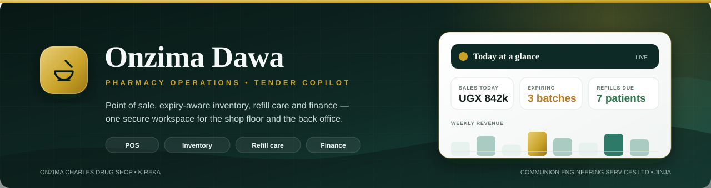
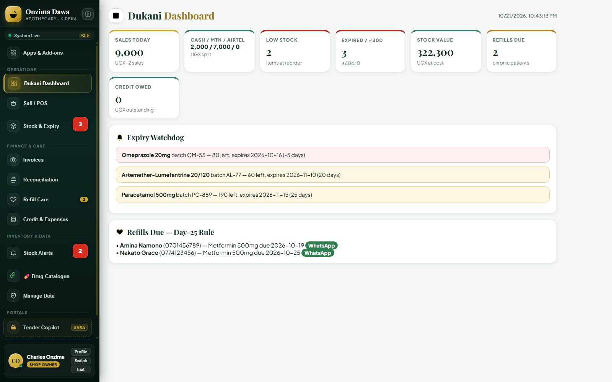
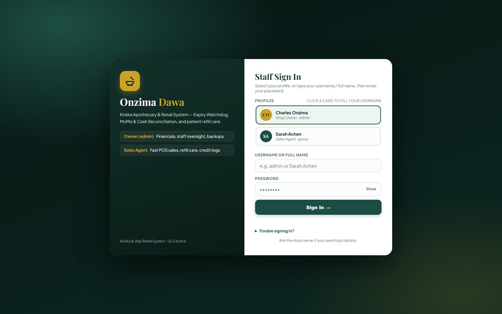
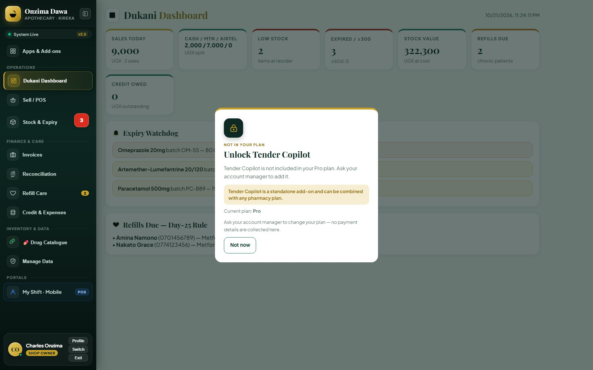
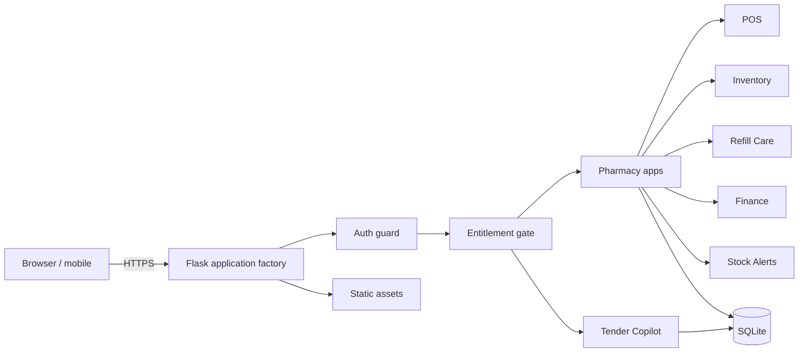

<div align="center">
  
  <h1>Onzima Dawa</h1>
  <p><strong>Pharmacy operations and tender intelligence in one secure workspace.</strong></p>
  <p>
    <a href="https://github.com/AndamaMoses/andama_mrfss_project/actions/workflows/ci.yml"></a>
    
    
    
    
  </p>
</div>

---

**Onzima Dawa** is a modular Flask application built for **Onzima Charles Drug Shop** (Kireka) and **Communion Engineering Services Ltd** (Jinja). It gives a pharmacy a fast point of sale, batch-level stock and expiry control, chronic-patient refill care, finance reconciliation, and stock alerts — and gives an engineering consultancy a structured **Tender Copilot** workspace for PPDA/UNRA opportunities.

Both products ship from one repository, one database, and one deployment. What a customer can open is decided by installation-level **entitlements** and enforced on the server, so the same codebase can be sold as Core, Pro, Growth, Tender Copilot, or a combined installation.

> **Pilot status:** Phase 6 observation is running from 2026-10-21 to 2026-11-04. See the [pilot runbook](docs/pilot-runbook.md) and [tracker](docs/pilot-tracker.md).

## What it does

| Workspace | Capabilities |
|---|---|
| **Point of Sale** | Multi-batch sales, cash / MTN MoMo / Airtel MoMo / credit, receipts, daily close, staff attribution |
| **Inventory & Purchases** | Products, supplier invoices, batch receipts, expiry watchdog, reorder levels, drug catalogue |
| **Refill Care** | Chronic-patient register and Day-25 refill reminders |
| **Finance** | Credit ledger, cash and mobile-money reconciliation, expenses, profit reporting |
| **Stock Alerts** | Low-stock and expiry SMS/WhatsApp alerts |
| **Tender Copilot** | PPDA/UNRA tender analysis, compliance matrix, risk flags, technical methodology drafting |
| **Apps & Plans** | Odoo-style launcher, server-side entitlement gate, plan-aware navigation and upgrade prompts |
| **Mobile Shift View** | A focused phone view for sales, refills due, and stock alerts |

## A look inside

| Daily operations | Secure sign-in | Plan-aware access |
|:---:|:---:|:---:|
|  |  |  |
| Sales, expiries, refills, and stock value in one view | Staff profiles, roles, and password sign-in | Features are enforced by plan, not just hidden in the UI |

The same workspace adapts to a phone for counter staff: [mobile shift view](docs/screenshots/staff-mobile.jpg).

## Plans

Entitlements are stored per installation and checked on every gated request. Revoking an app hides it and returns `403` at the API; it never deletes business data.

| Plan | Included apps | Intended customer |
|---|---|---|
| **Core** | POS, Inventory | New pharmacy starter |
| **Pro** | Core + Refill Care, Finance | Established pharmacy |
| **Growth** | Pro + Stock Alerts | Pharmacy that wants proactive stock alerts |
| **Tender Copilot** | Tender only | Consultancy or standalone workspace |
| **Combined** | Pro + Tender add-on | Pharmacy that also bids for tenders |
| **Legacy** | All apps | Onzima only — grandfathered, not sold |

## Quick start

**Requirements:** Python 3.12+ and PowerShell (or any shell).

```powershell
git clone https://github.com/AndamaMoses/andama_mrfss_project.git
cd andama_mrfss_project

python -m venv .venv
.\.venv\Scripts\Activate.ps1
$env:PYTHONIOENCODING = "utf-8"

python -m pip install --upgrade pip
python -m pip install -r requirements-dev.txt

python run.py
```

Open:

- **Pharmacy workspace** — <http://127.0.0.1:5000>
- **Tender Copilot** — <http://127.0.0.1:5000/tender>

On an empty database the first boot creates the bootstrap accounts and prints them to the console. **Change every bootstrap password before the app is reachable by anyone else.** Restarts never reset an existing password.

New installations should start on Core:

```powershell
$env:DRUGSHOP_BUNDLE = "core"
python run.py
```

Onzima's existing installation keeps the grandfathered `legacy` default. The full first-boot, backup, activation, and handover checklist is in the [onboarding runbook](docs/onboarding-runbook.md).

### Staff sign-in and recovery

Staff can sign in with their username, full profile name, or first/last name —
matching is case-insensitive. The sign-in form warns when Caps Lock is on.

If someone forgets a password:

1. A Shop Owner signs in and opens **Team → Staff accounts → Reset password**.
2. If no admin can sign in, use the CLI from the project root:

   ```powershell
   .\.venv\Scripts\flask.exe --app run reset-password admin
   ```

   The command prompts for the new password twice and never prints it back.

## Configuration

All settings are environment variables read by [`config.py`](config.py). The app does **not** auto-load a `.env` file; export variables in your shell or set them in your process manager. See [`.env.example`](.env.example) for a starting point.

| Variable | Default | Purpose |
|---|---|---|
| `SECRET_KEY` | Development key | Session signing key. **Required** by `ProdConfig`; use a long random value from a secret store. |
| `DRUGSHOP_DB` | `instance/drugshop.db`, else `drugshop.db` | SQLite database path. |
| `DRUGSHOP_UPLOADS` | `instance/uploads`, else `uploads` | Uploaded document directory. |
| `DRUGSHOP_BUNDLE` | `legacy` | Bundle seeded on first boot: `core`, `pro`, `growth`, `tender`, or `legacy`. |
| `SUPPORT_WHATSAPP` | empty | Support number shown on upgrade prompts. |
| `SESSION_COOKIE_DOMAIN` | unset | Set only when Tender Copilot is served from a subdomain of the pharmacy install. |
| `FLASK_DEBUG` | `0` | Set to `1` for local auto-reload. Never enable in production. |

Deploy behind HTTPS, set a strong `SECRET_KEY`, and keep `instance/` (database, uploads, backups, logs) outside version control.

## Architecture



The app is a **modular monolith**: an application factory in `drugshop/__init__.py`, one blueprint per domain, one SQLite database, and a single forward-only migration stream. The entitlement catalog lives in `drugshop/apps/registry.py`; the request gate lives in `drugshop/apps/guards.py`.

```text
andama_mrfss_project/
├── drugshop/
│   ├── apps/          # Plan catalog, entitlements, server-side gate, launcher API
│   ├── auth/          # Sign-in, roles, bootstrap users
│   ├── sales/         # Point of sale and receipts
│   ├── inventory/     # Products, batches, expiry, supplier invoices
│   ├── patients/      # Refill care
│   ├── finance/       # Reconciliation, credit, expenses
│   ├── notifications/ # SMS / WhatsApp stock alerts
│   ├── reporting/     # Dashboard, exports, backups
│   ├── tender/        # Tender Copilot analysis and methodology
│   ├── migrations/    # Forward-only SQL migrations
│   ├── static/        # JavaScript, brand assets, web manifest
│   └── templates/     # Workspace, sign-in, staff, Tender Copilot
├── docs/              # Runbooks, plans, business context
├── scripts/           # Smoke checks, dry run, pilot metrics
├── tests/             # Pytest suite
├── config.py          # Environment-overridable configuration
└── run.py             # Single entry point
```

## Quality

```powershell
python -m pytest -q          # 225 tests
python -m ruff check .       # Lint (E, F, I, BLE, S rules)
```

CI runs lint and the full test suite on every push and pull request. With the app running, the HTTP smoke script checks plan-aware access:

```powershell
$env:SMOKE_PASSWORD = "the-admin-password"
powershell -ExecutionPolicy Bypass -File scripts\smoke.ps1 -Plan core -Username admin
```

The packaging dry run copies the database, applies the additive migration, seeds a bundle, checks access, downgrades, re-upgrades, and rehearses a restore — without writing to the source database:

```powershell
python scripts\dry_run_packaging.py --bundle legacy `
    --restore-backup "instance\backups\drugshop-pre-packaging-20261021-161243.db"
```

## Operations

| Document | Use it for |
|---|---|
| [Onboarding runbook](docs/onboarding-runbook.md) | Backup, first boot, plan activation, smoke checks, handover |
| [Rollback runbook](docs/rollback-runbook.md) | Access, code, and database rollback; restore rehearsal |
| [Pilot runbook](docs/pilot-runbook.md) | Onzima Legacy deployment and the two-week observation |
| [Pilot tracker](docs/pilot-tracker.md) | Baseline, daily metrics, support tickets, exit decision |
| [Tender standalone](docs/tender-standalone.md) | Separate-domain mapping, shared sign-in, demo hygiene |
| [Packaging plan](docs/packaging-plan.md) | Entitlements, launcher, and phased delivery record |
| [Business context](docs/business-context.md) | Customer research behind both products |
| [Strategy playbook](docs/strategy-playbook.md) | Commercial rollout notes for the Kampala–Jinja corridor |

## Security

- Passwords are hashed with Werkzeug; default accounts are only created when the user table is empty.
- Session cookies are `HttpOnly` and `SameSite=Lax`; production refuses to start without `SECRET_KEY`.
- Responses deny framing, MIME sniffing, and search indexing by default.
- Every gated endpoint is checked server-side, not just hidden in the UI.
- SQL uses parameter binding; uploads and exports are scoped to the authenticated installation.
- Backups are available from the admin surface and documented in the operations runbooks.

Please do not open a public issue for a suspected vulnerability. Follow [SECURITY.md](SECURITY.md).

## Contributing

Development setup, migration rules, and the review checklist are in [CONTRIBUTING.md](CONTRIBUTING.md). Commits follow a conventional style (`feat:`, `fix:`, `docs:`, `chore:`).

## Contact

**Andama Moses** — Communion Engineering Services Ltd, Jinja, Uganda<br>
[andamamoses42@gmail.com](mailto:andamamoses42@gmail.com) · [GitHub](https://github.com/AndamaMoses)

<sub>Built for the shop floor and the tender desk. © 2026 Communion Engineering Services Ltd.</sub>
